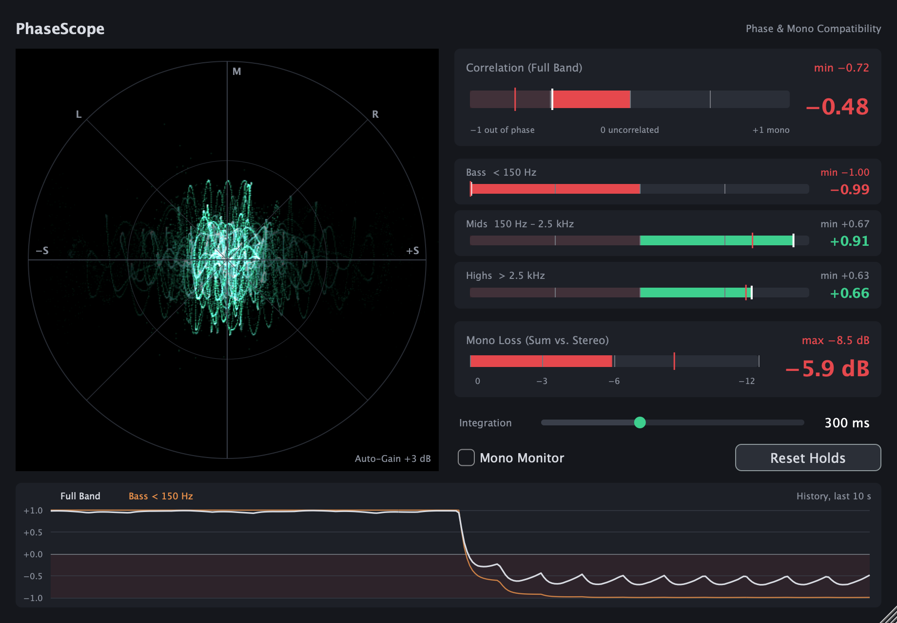
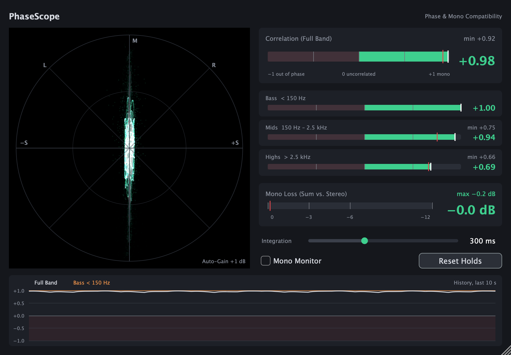
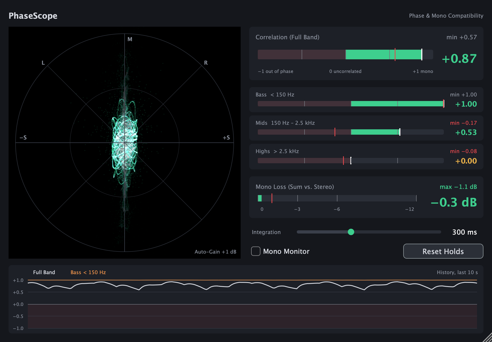

# PhaseScope

**Phase and mono compatibility analyzer for mixing and mastering** – VST3 / AU / Standalone, built with JUCE 8.

PhaseScope shows not only *whether* your mix has phase problems, but *where* they are: a phase-flipped bass on an otherwise healthy mix is spotted at a glance.



## Download

Grab the latest version from the [Releases](../../releases/latest) page.

| File | Contents |
|---|---|
| `PhaseScope-macOS-AU.zip` | Audio Unit (Logic Pro, GarageBand, …) |
| `PhaseScope-macOS-VST3.zip` | VST3 plugin |
| `PhaseScope-macOS-Standalone.zip` | Standalone app |
| `PhaseScope-Windows-VST3.zip` | VST3 plugin (64-bit) |
| `PhaseScope-Windows-Standalone.zip` | Standalone app (64-bit) |

macOS builds are universal (Apple Silicon + Intel) and run on macOS 12 or later. Every ZIP includes a `README.txt` with installation steps and the license files.

### Installing on macOS

1. Copy `PhaseScope.component` to `~/Library/Audio/Plug-Ins/Components/` and/or `PhaseScope.vst3` to `~/Library/Audio/Plug-Ins/VST3/`.
2. The builds are not notarized by Apple, so macOS may block them the first time. Remove the quarantine flag once in Terminal:
   ```bash
   xattr -dr com.apple.quarantine ~/Library/Audio/Plug-Ins/Components/PhaseScope.component ~/Library/Audio/Plug-Ins/VST3/PhaseScope.vst3
   ```
3. Rescan plugins in your DAW. In Logic Pro you'll find it under *Audio Units → PhaseScope*.

### Installing on Windows

1. Copy the `PhaseScope.vst3` folder to `C:\Program Files\Common Files\VST3\`.
2. Rescan plugins in your DAW.

The Windows builds are not code-signed, so SmartScreen may warn when you start the standalone app for the first time (*More info → Run anyway*).

## What it shows

| Section | What it tells you |
|---|---|
| **Goniometer** | Lissajous display (M vertical, S horizontal) with afterglow and auto-gain. A vertical line = mono, a circle/cloud = wide stereo, horizontal spread = out-of-phase content. |
| **Correlation (Full Band)** | Correlation from −1 to +1 with min hold. Red = negative (cancellation when summed to mono). |
| **Correlation per band** | Bass < 150 Hz, Mids 150 Hz – 2.5 kHz, Highs > 2.5 kHz (Linkwitz-Riley crossover). Shows *where* the problem is. |
| **Mono Loss** | Level of the mono sum relative to the stereo level in dB, with max hold. 0 dB = mono, about −3 dB = uncorrelated, much lower = cancellation. |
| **History** | Full-band and bass correlation over the last 10 seconds. |

### Examples

| Healthy mix | Wide stereo, mono bass |
|---|---|
|  |  |
| Narrow vertical trace, all bands green, no level lost in mono. | Wide cloud in the goniometer, decorrelated highs – but the bass stays mono and the mono loss is minimal. |

The screenshot at the top shows the problem case: the bass flips polarity on one channel. The bass band drops to −1, the full-band correlation goes negative and the mono sum loses almost 6 dB.

## Controls

- **Integration** (50–3000 ms, default 300 ms): how sluggish the correlation measurement is.
- **Mono Monitor**: sums the output to mono so you can listen for cancellation. Otherwise audio passes through untouched.
- **Reset Holds**: resets the min/max holds (e.g. before playing the song again).

## Usage

Put it as the last plugin on the master bus (after the limiter), so it measures what actually gets played back.

## Building from source

Only needed for Linux or development. Requirements: CMake ≥ 3.22, a C++17 compiler and Git; JUCE is downloaded automatically.

```bash
cmake -B build -DCMAKE_BUILD_TYPE=Release
cmake --build build --config Release
```

The plugins end up in `build/PhaseScope_artefacts/Release/`. On Linux you'll need the usual JUCE dependencies (`libasound2-dev libx11-dev libxrandr-dev libxinerama-dev libxcursor-dev libfreetype-dev libfontconfig1-dev`). The screenshots in `docs/` are rendered by `tools/Screenshots.cpp` (configure with `-DPHASESCOPE_BUILD_SCREENSHOTS=ON`).

## License

PhaseScope is licensed under the [GNU Affero General Public License v3.0](LICENSE) (AGPLv3). It uses the [JUCE framework](https://juce.com), which is also available under the AGPLv3 for open-source projects.
